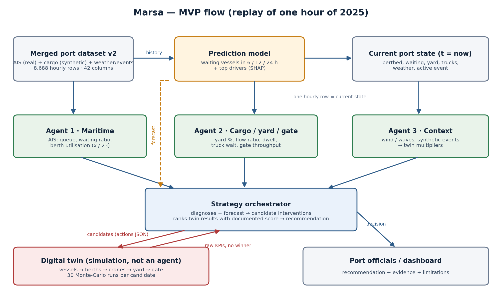

# Marsa (مرسَى) — Predictive Port Digital Twin

**AgentX Hackathon · Logistics & Ports track · Challenge (Ministry of Transport and Logistic Services): *Predicting cargo congestion and shipment delays in ports.***

Marsa forecasts port congestion from real vessel-traffic (AIS) data, lets three specialist AI agents diagnose
*where* the pressure is (sea side, yard/gate, external context), asks a strategy agent to propose interventions,
tests every intervention in a digital twin, and returns a ranked recommendation with evidence.
Nothing is executed automatically — the port operator takes the final decision.

<p align="center"></p>

---

## 1. How Marsa works (one decision cycle)

| Step | Component | What it does | Where |
|---|---|---|---|
| 1 | **Port state** | One hour of the merged dataset is treated as "now" (replay of 2025) | `src/marsa/data/load.py` |
| 2 | **Prediction model** | XGBoost forecasts congestion risk in the next 6 h + risk level | `src/marsa/model/` · `prediction_model/` |
| 3 | **Agent 1 · Maritime** | Vessel queue and waiting ratio from AIS (LA + Long Beach, cargo + tankers) | `src/marsa/agents/maritime_agent.py` |
| 4 | **Agent 2 · Cargo** | Yard occupancy, container flow, dwell, truck/gate pressure | `src/marsa/agents/cargo_agent.py` |
| 5 | **Agent 3 · Context** | Observed weather, synthetic external events, local calendar | `src/marsa/agents/events_weather_agent.py` |
| 6 | **Evidence investigation** | Existing bounded Gemini investigation and deterministic fallback; historical context only | `src/marsa/pipeline.py` |
| 7 | **Unified website twin** | Freeze an AIS cohort with explicit synthetic normalized workloads and yard inventory; compare native Coupled scenarios | `src/marsa/twin/unified.py` |
| 8 | **Strategy recommendation** | Rank queue exposure in vessel-hours (baseline-first ties); report completions and unloading separately | `src/marsa/twin/unified.py` |
| 9 | **Dashboard / API** | Main root design; operational cards, replay and manual decisions share the frozen Hybrid contract | `Marsa updated.html` · `src/marsa/api/` |

Design rules: agents describe and diagnose, they never invent numbers. Gemini can optionally select validated
historical diagnostics inside Strategy; Python computes the facts and hypotheses. Narrative rewriting
is rejected if it adds numbers or causal claims; every value carries provenance (`OBSERVED`, `DERIVED`,
`SYNTHETIC`, `SIMULATED`); the twin never picks a winner; the dashboard shows only values returned by the API.

The current prototype configuration enables Strategy investigation. Set `strategy_investigation.enabled: false`
to retain legacy behavior. See [configuration, tool contracts, and limitations](docs/STRATEGY_INVESTIGATION.md)
and the [implementation and validation report](reports/STAGE2_DYNAMIC_TOOL_SELECTION_IMPLEMENTATION.md).

An independent [adaptive candidate policy](docs/ADAPTIVE_CANDIDATES.md), also enabled in the prototype configuration, uses complete historical
evidence to prioritize the existing experiments for simulation. It retains the legacy candidate pool,
actions and parameters; evaluation priority does not determine simulated ranking or the winner.

---

## 2. Run it — step by step

### Requirements
- Python **3.11 or newer** (`python --version`)
- Git
- (Optional) a Gemini API key from https://aistudio.google.com → *Get API key*

### Step 1 — clone
```bash
git clone https://github.com/AnwarAldahan/Marsa.git
cd Marsa
```

### Step 2 — create and activate a virtual environment
```powershell
# Windows (PowerShell)
python -m venv .venv
.\.venv\Scripts\Activate.ps1
```
```bash
# macOS / Linux
python -m venv .venv
source .venv/bin/activate
```
You should now see `(.venv)` at the start of the prompt.
If PowerShell refuses to run the script: `Set-ExecutionPolicy -Scope CurrentUser RemoteSigned` (once), then retry.

### Step 3 — install dependencies
```bash
pip install -r requirements.txt
```

### Step 4 — (optional) configure Gemini
Without a key, enabled investigation uses the deterministic diagnostic router and the recommendation uses a deterministic summary.
With a key, the API can use Gemini for diagnostic selection and its existing optional narrative.
```powershell
copy .env.example .env        # macOS/Linux: cp .env.example .env
```
Open `.env` and set your key — no quotes, no spaces:
```
GEMINI_API_KEY=your_key_here
```
`.env` is git-ignored and must never be committed. Each should creates their own.

### Step 5 — check everything works
```bash
python -m pytest -q tests
python -m ruff check src tests scripts
```
Expected: all tests pass and ruff reports no issues. Automated tests block live HTTP and do not consume Gemini credits.

### Step 6 — run one decision cycle from the command line
```bash
python scripts/run_pipeline.py 2025-07-10T19:00:00Z --save
```
Timestamps must be **UTC with a trailing `Z`** and must exist in the 2025 timeline.
Output: the decision-support JSON in the terminal and `outputs/run_20250710T19.json`.

### Step 7 — start the backend (terminal 1)
```powershell
$env:PYTHONPATH="src"; python -m uvicorn marsa.api.main:app --reload      # Windows
```
```bash
PYTHONPATH=src python -m uvicorn marsa.api.main:app --reload             # macOS / Linux
```
Wait for `Application startup complete`. Swagger UI: http://127.0.0.1:8000/docs

### Step 8 — open the canonical dashboard
Open **http://127.0.0.1:8000/**. FastAPI serves the root `Marsa updated.html` directly; no separate frontend server is needed.
Choose a historical hour, then open the existing Digital Twin controls. Comparisons and replay use the same frozen Hybrid scenario.
The 23 slots are an abstract demo assumption, not verified available operational berths. Cargo quantities are synthetic normalized units, never TEU.
See [the unified contract and limitations](docs/UNIFIED_TWIN.md) for parameters, API examples and a controlled congestion experiment.

The CLI above and `/api/decision-support/analyze` retain their legacy ranking semantics for compatibility.
`dashboard/marsa.html` is a legacy reference interface, not the canonical unified website.

### Step 9 — stop
`Ctrl+C` in the backend terminal. Restart after Python/configuration changes; refresh after editing the root HTML.

### Legacy replay examples (legacy API / reference dashboard only)
| Hour (UTC) | Stress | Why |
|---|---|---|
| `2025-07-10T19:00:00Z` | none | busy hour: 17 of 23 LA berths used, 1 vessel waiting for its berth time → "no intervention needed" |
| `2025-01-04T19:00:00Z` | none | 21 of 23 berths used, the highest in 2025 |
| `2025-01-03T04:00:00Z` | 6 berths closed, arrivals ×2 | berth shortage; all three options give different results |
| `2025-01-13T18:00:00Z` | none | active synthetic external event |
| `2025-05-14T06:00:00Z` | none | calm |

---

## 3. API

| Method | Path | Body | Returns |
|---|---|---|---|
| GET | `/health` | — | liveness |
| POST | `/api/agents/maritime/investigate` | `{"timestamp_utc": "2025-07-10T19:00:00Z"}` | Agent 1 assessment |
| POST | `/api/agents/cargo/investigate` | same | Agent 2 assessment |
| POST | `/api/agents/events-weather/investigate` | same | Agent 3 assessment |
| POST | `/api/decision-support/analyze` | same, optional `"stress": {"berths_closed": 6, "arrival_multiplier": 2}` and `"added": [{"arrival_in_hours": 3, "length_m": 330}]` | full cycle: state, forecast, agents, twin results, recommendation |
| POST | `/api/twin/simulate` | `timestamp_utc`, `actions: [{"type": "gate_capacity", "value": "max_recorded"}]`, optional `stress`, `added` | one decision vs no change, with sources (no ranking) |
| GET | `/api/twin/vessels?timestamp_utc=…` | — | vessels with stays completed before the hour (IMO/MMSI, length, visits, median stay) |

Example from PowerShell (backend running on port 8000):
```powershell
Invoke-RestMethod -Method Post -Uri http://127.0.0.1:8000/api/decision-support/analyze `
  -ContentType application/json -Body '{"timestamp_utc":"2025-07-10T19:00:00Z"}'
```

Every response carries `reasoning_mode`: `deterministic`, `llm_assisted`, or `deterministic_fallback`
(LLM answer rejected by the guardrails). Errors: 404 = hour not in timeline, 422 = bad timestamp or stress value.

---

## 4. Repository structure

```
Marsa/
├── README.md
├── requirements.txt · pyproject.toml · .env.example · .gitignore · .gitattributes
├── config/port_config.yaml        ★ every port parameter and assumption, tagged SOURCE / DERIVED / ASSUMPTION
├── data/
│   ├── external/                  berth-occupancy columns derived from raw AIS
│   └── processed/
│       ├── merged_port_dataset_2025_v1.csv   pure merge of the three agent datasets (frozen)
│       ├── merged_port_dataset_2025_v2.csv   v1 + berth columns  ← runtime input
│       ├── la_cargo_calls_2023_2025.csv      every LA cargo-vessel berth call from raw AIS  ← twin input
│       ├── event_registry_2025.csv           synthetic events registry
│       └── ml_modeling_table_c1.parquet      AIS-only table (2023–2025) used by the C1 model
├── src/marsa/
│   ├── data/          loader, hourly snapshot, gap-safe features/targets
│   ├── model/         runtime inference contract for the prediction model
│   ├── agents/        maritime · cargo · events_weather · strategy · gemini/llm · remote (HTTP adapter)
│   ├── twin/          calls (AIS state at an hour) · engine (berth simulation) · adapter · scoring
│   ├── api/           FastAPI app, routes, schemas
│   ├── provenance/    provenance types
│   └── pipeline.py    one decision cycle
├── prediction_model/  training code, artifacts and results of the cargo-congestion model (XGBoost 1/3/6/12 h)
├── artifacts/models/  C1 maritime congestion model (XGBoost) + metadata + SHAP explainers
├── reports/           data audit, model evaluation, calibration, thresholds
├── scripts/           run_pipeline.py · build_v2_dataset.py · berth_occupancy_from_ais.py · build_la_cargo_calls.py · events/weather builders
├── dashboard/         marsa.html (dashboard, API-driven only) · README_DASHBOARD.md
├── tests/             agents, API, twin, features, integration, prediction pipeline
└── docs/              DATA_DICTIONARY · ARCHITECTURE · LIMITATIONS · NEXT_STEPS · figures
```

---

## 5. Data

| Layer | Source | Provenance | Notes |
|---|---|---|---|
| Vessel traffic | NOAA AIS via Kaggle *LA/LB Maritime Trajectory & AIS Dataset 2023-2025* (CC BY 4.0) | OBSERVED → hourly DERIVED | 21.7 M pings → 8,688 hours of 2025 |
| Berth occupancy | derived from raw AIS (cargo vessels stationary inside the LA port area) | DERIVED | validated against Marine Exchange daily counts |
| LA cargo calls (twin) | derived from raw AIS 2023-H2 → 2025 (`scripts/build_la_cargo_calls.py`) | OBSERVED → DERIVED | 4,704 berth stays (every stay as recorded); arrival, wait, berth and service time of each vessel |
| Weather | Open-Meteo (LA/LB), hourly | OBSERVED | wind, wave height, WMO code |
| Cargo / yard / gate | generated, calibrated to official Port of Los Angeles 2025 monthly TEU and PMSA dwell times | SYNTHETIC | port-level, normalised yard scale (10,000 units) |
| External events | generated with a fixed seed, independent of AIS | SYNTHETIC | 15 events, 172 hours |

Port of Los Angeles is a **stand-in**: Eastern Province port data was requested and not made available.
Everything port-specific lives in `config/port_config.yaml` (23 container berths — the sum of the per-terminal berth counts in the port's official *Port 101* brochure).
72 source hours are missing from the AIS timeline and are deliberately **not** filled.
Full column list: `docs/DATA_DICTIONARY.md`.

---

## 6. Prediction models

| Model | Target | Inputs | Test period | Result |
|---|---|---|---|---|
| **C1 maritime congestion** (`artifacts/models/`) | observed AIS label (≥ 17 waiting vessels *or* high density + low speed) in the next 6 h | AIS + weather | Jul–Dec 2025 | ROC-AUC 0.97 · PR-AUC 0.83 (persistence baseline 0.49) |
| **Cargo-congestion proxy** (`prediction_model/`, used at runtime) | rule-based proxy from cargo/yard/gate stress, next 1/3/6/12 h | AIS + synthetic cargo | walk-forward folds | `prediction_model/final_proxy/results/` |

The C1 model has an **observed** target, so its accuracy is the headline number. The runtime proxy model extends
the forecast to the landside; because its target is synthetic, its accuracy is internal consistency, not
real-world accuracy (see `docs/LIMITATIONS.md`).

---

## 7. Digital twin

Berths of the Port of Los Angeles (cargo vessels only) plus the yard and gate. The vessel starting state at any hour comes from AIS:
which vessels are at a berth (and when each one really left), which are waiting for an LA berth (destination
taken from where the vessel berthed next), and which arrive in the next 24 h, each with its real service time.
Ports know the next day's arrivals from advance arrival notices, so the twin uses the real arrival schedule.

Without a stress scenario the twin reproduces AIS exactly (tested: every vessel berths at its recorded time).
In 2025 LA berths never filled (max 21 of 23) and 5.6 % of cargo stays came after a wait (100 of 1,772) — for reasons the data does not
show (terminal windows), so those waits are kept as recorded. A stress scenario chosen by the user (berths
closed, compressed arrival schedule) makes berths scarce; vessels then also wait for a free berth
(*capacity wait*). Actions: `queue_policy` (FCFS / shortest real service first), `add_berths` and
`gate_capacity`. The simulation is deterministic (no random sampling).

Yard and gate come from the Cargo agent's file (synthetic, calibrated): the twin replays
`containers_in_yard` exactly (the file satisfies yard[t] = yard[t-1] + arrivals − departures). The gate
action clears up to N containers per hour; the data-based value is the highest hourly
`container_departures` the file recorded up to the chosen hour (no future values), or a number typed by the
user. The yard does not change vessel waiting (no data on that effect). The twin returns vessel and yard
measures side by side; options are listed by total vessel-hours waiting and the Strategy agent reads both.

The user can add vessels for a what-if test. An added vessel's stay is: the median of its own earlier LA
stays (matched by IMO, else MMSI), else the median stay of the k vessels closest in length (k = 5, chosen
by `scripts/select_similar_k.py`: lowest error on 2025 stays using only earlier stays), or a duration typed
by the user. Only stays completed before the chosen hour are used.

---

## 8. Tech stack

Python 3.11 · pandas / NumPy / PyArrow · XGBoost · scikit-learn · SHAP-style explainers · Pydantic v2 ·
FastAPI + Uvicorn · Gemini API (optional narrative) · pytest · ruff · HTML/JS dashboard.

---

## 9. Limitations and next steps

`docs/LIMITATIONS.md` and `docs/NEXT_STEPS.md`. In short: stand-in port, container chain only, synthetic landside,
sea-side-only twin of one port treated as one berth pool, approximate berth count.
With Mawani / TOS data for King Abdulaziz Port the same code runs unchanged: only the config and the three
input datasets change.

---

## 10. Team — AgentX 2026 · Team Marsa

| Name | GitHub | Role |
|---|---|---|
| Anwar Aldahan | [@AnwarAldahan](https://github.com/AnwarAldahan) | Data integration, repository, digital twin, dashboard wiring & synthetic operations data |
| Sajedah Alqudaihi | [@Sajedah25 ](https://github.com/Sajedah25) | Maritime agent (AIS) & synthetic operations data & Dashboard design |
| Anfal bamardouf | [@nbamardouf-source](https://github.com/nbamardouf-source) | Cargo agent & synthetic operations data &Prediction model |
| Fatima Alawami | [@Fatima Alawami](https://github.com/FatimaAlawami3) | Events & weather agent, API, LLM integration & synthetic operations data|

